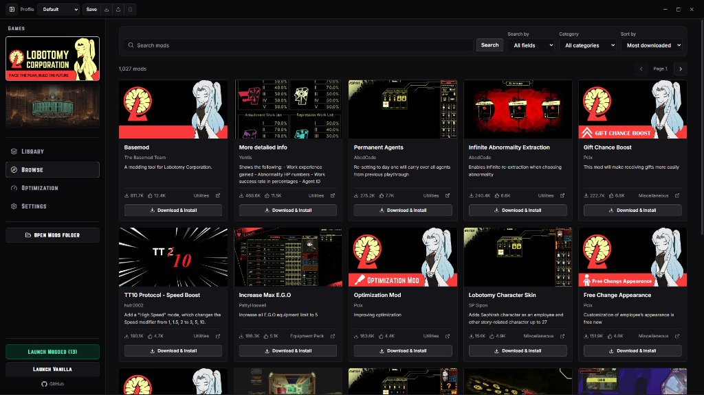

[](https://github.com/Rowrow620/altelier/actions/workflows/ci.yml)
[](https://github.com/Rowrow620/altelier/releases)
[](LICENSE)
[](https://github.com/Rowrow620/altelier/releases)

Windows desktop mod manager for **Lobotomy Corporation** and **Library of Ruina**.



## What it does

- Detects Steam installs for Lobotomy Corporation and Library of Ruina, with support for custom mod folders (including Lobotomy Mod Manager).
- Manage local mods in a sortable table: enable or disable individual mods or everything at once, inspect summaries, check Nexus for updates, and save or export/import profiles.
- Install `.zip` mod archives via drag-and-drop, or browse Nexus Mods directly inside the app (with optional Nexus Premium API key support in Settings for one-click **Download & Install**).
- Optimization tab checks BaseMod/Harmony setup health, fixes nested or outdated mod folder layouts, lists overlapping files between enabled mods, backs up/restores Unity saves, and configures `-popupwindow` / `-nolog` launch flags.
- Launch modded or vanilla directly from the sidebar.

## Running and building

Download the Windows installer from [Releases](https://github.com/Rowrow620/altelier/releases), or run from source with Node.js and `pnpm`:

```bash
pnpm install
pnpm run dev          # run Electron + Vite in dev mode
pnpm run check        # typecheck, test suite, and production build
pnpm run package:win  # build Windows NSIS installer into release/
```

To launch an already-built copy without a terminal window on Windows, open `Launch Atelier.wsf` (or run `pnpm start`). Clicking the tray icon brings the window back to focus.

## Notes

- Disabling a native mod moves its folder to a sibling `.atelier-disabled` folder (such as `BaseMods.atelier-disabled`) instead of deleting it.
- Lobotomy Corporation native mods require BaseMod (or Lobotomy Mod Manager). Library of Ruina loads local mods from `LibraryOfRuina_Data/Mods` alongside Steam Workshop items.
- Nexus Browse excludes 18+ listings. Download those manually from Nexus Mods and install the `.zip` using **Import Mod**.

## License

Source code is licensed under the [Apache License 2.0](LICENSE).

- Typography uses [Norwester](src/assets/fonts/norwester.woff) by Jamie Wilson under the SIL Open Font License 1.1.
- Unofficial community tool. Game names, banners, and character artwork belong to Project Moon.
