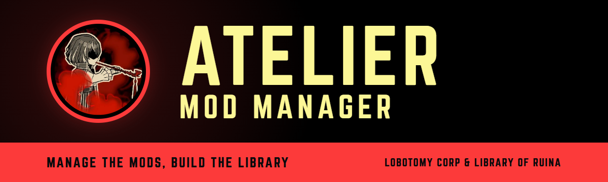

[](https://github.com/Rowrow620/altelier/actions/workflows/ci.yml)
[](https://github.com/Rowrow620/altelier/releases)
[](LICENSE)
[](https://github.com/Rowrow620/altelier/releases)

Desktop mod manager for **Lobotomy Corporation** and **Library of Ruina**.


---

## Features

- **Dark UI & Collapsible Sidebar:** Charcoal chrome (`#09090b`), dark workspace (`#0e0e10`), silver-zinc accents (`#d4d4d8`), offline `Norwester` sidebar typography, and game banner selectors for **Lobotomy Corporation** and **Library of Ruina**.
- **Mod Library Table:** Multi-column table (`Status`, `Mod Name`, `Author`, `Version`, `Category`, action controls) with search, status and category filters, column sorting, **Enable all** / **Disable all**, **Check updates**, a mod summary dialog, and a centered **Import Mod** action.
- **Browse Mods & Nexus Downloads:** Search Nexus Mods by name, author, or all fields, filter by category, view mod summaries and file lists in an accessible `<dialog>`, and download/install archives directly using an optional Nexus Mods Premium API key in **Settings** (adult listings are excluded).
- **Optimization & Compatibility:** Checks BaseMod and Lobotomy Mod Manager installations, detects structural mod layout issues with one-click fixes, scans enabled mods for overlapping file conflicts, backs up and restores Project Moon save data, cleans stale temporary folders, and configures Unity launch flags (`-popupwindow`, `-nolog`).
- **Sidebar Launchers & Profiles:** Bottom-left **Launch Modded ([X])**, **Launch Vanilla**, and **GitHub** actions in the sidebar, plus top-bar profile switching, saving, JSON export/import, and deletion.
- **Automatic Metadata Detection:** Reads `Info.txt`, `README.md`, and config files to extract mod names, authors, versions, and summaries.
- **Drag-and-Drop ZIP Installation:** Drop a `.zip` mod archive onto the import dialog to validate, unpack, and activate it.
- **Atomic File Safety:** ZIP archives are validated and unpacked in a temporary transaction directory with rollback recovery on restart. Replacing and deleting a mod require confirmation.
- **Directory Detection:** Detects Steam libraries from VDF manifests and supports custom mod folders (such as `E:\Lobotomy mod manager\mod list`).

---

## Quick Start

### Launching the App
On Windows, double-click `Launch Atelier.wsf` to open the built app without a console window. You can also launch it from an existing terminal:
```bash
pnpm start
```

While Atelier is running, click its Windows tray icon to bring the window forward.

### Development Mode (with hot-reload)
```bash
pnpm run dev
```

To see renderer logs in the terminal while running the built app, use `pnpm debug`.

### Build for Production
```bash
pnpm run build
```

### Package Windows Installer
```bash
pnpm run package:win
```

Outputs an unpacked portable directory (`pnpm run package:dir`) and Windows x64 NSIS installer under `release/`.

### Contributor checks

Run `pnpm check` to type-check the renderer, run the test suite (`node --test`), and build the app.

Imports support ZIPs up to 512 MB, with up to 2 GB unpacked, 256 MB per file,
and 20,000 files and folders. Links, junctions, duplicate names, and paths that
leave the mod folder are rejected. The mods folder itself must be a real folder.

Settings are saved through `electron/config/store.js`. Path checks live in
`electron/files/paths.js`, archive inspection and installation in
`electron/install`, diagnostics and backups in `electron/library`, and app message
validation in `electron/ipc/register.js`.
The safety and feature regression tests run with `pnpm test`.

### How Browse works

For 18+ mods, download them directly from Nexus Mods. If the download is a supported ZIP, use **Import Mod** in Atelier and select the game.

`BrowseOnlineView` calls `atelierApi.searchCatalog` with the game, query,
page, sort, and filters, and `CatalogDetailsModal` queries `getCatalogFiles` for
available archive versions.
The preload bridge passes requests to Electron's main process. The catalog
service validates each request and saves successful search pages in Electron's
user data directory. Browse reuses matching results for five minutes and can show
them offline for up to seven days. The offline cache only serves explicitly
non-adult listings.

The Nexus adapter sends Atelier's name and version, queries the Nexus v2 GraphQL
API for search and file listings, and optionally uses a user-supplied Nexus
Mods Premium personal API key against `download_link.json` for direct
**Download & Install**.
The adapter, downloader, and catalog service live in `electron/catalog`.
The preload and renderer share request and response types in `shared/contracts.ts`.
The catalog and download tests run offline against mocked Nexus responses.

### Game folders and launch modes

- **Lobotomy Corporation** uses a BaseMod install for native mods, or an external
  Lobotomy Mod Manager installation when configured. Vanilla requires a clean game
  install.
- **Library of Ruina** loads local mods from
  `LibraryOfRuina_Data/Mods` in modded mode. A legacy BaseMod-patched install
  requires a separate clean install for Vanilla. Steam Workshop items appear
  in the library and are toggled through Steam or managed UI-side.
- For native mods, disabling moves the folder to a sibling storage directory.
  Enabling moves it back.

### Installing, optimizing, and profiles

- Use **Import Mod** below the Library table for a `.zip` archive containing a
  mod, or **Download & Install** in **Browse** with a Nexus Premium API key.
  Atelier recognises standard BaseMod and Ruina layouts and can unwrap nested
  folders or migrate Ruina structures from the **Optimization** tab.
- Use **Check updates** in Library to compare installed versions against Nexus
  releases and flag declared requirements.
- Use **Save**, export/import, and delete controls in the **Profile** bar to
  save, share, switch, or remove per-game native mod layouts.
